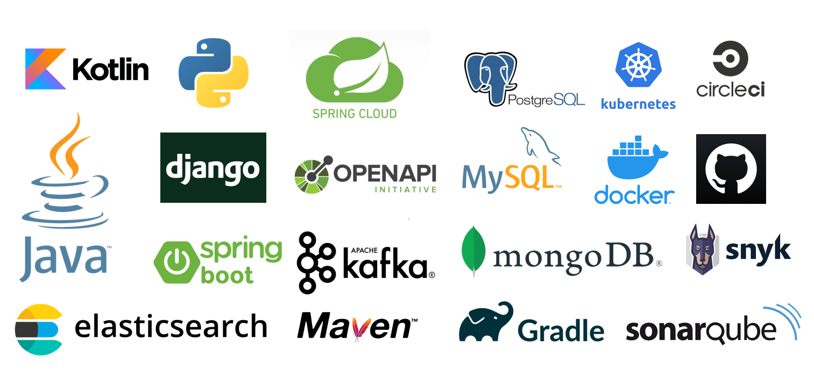
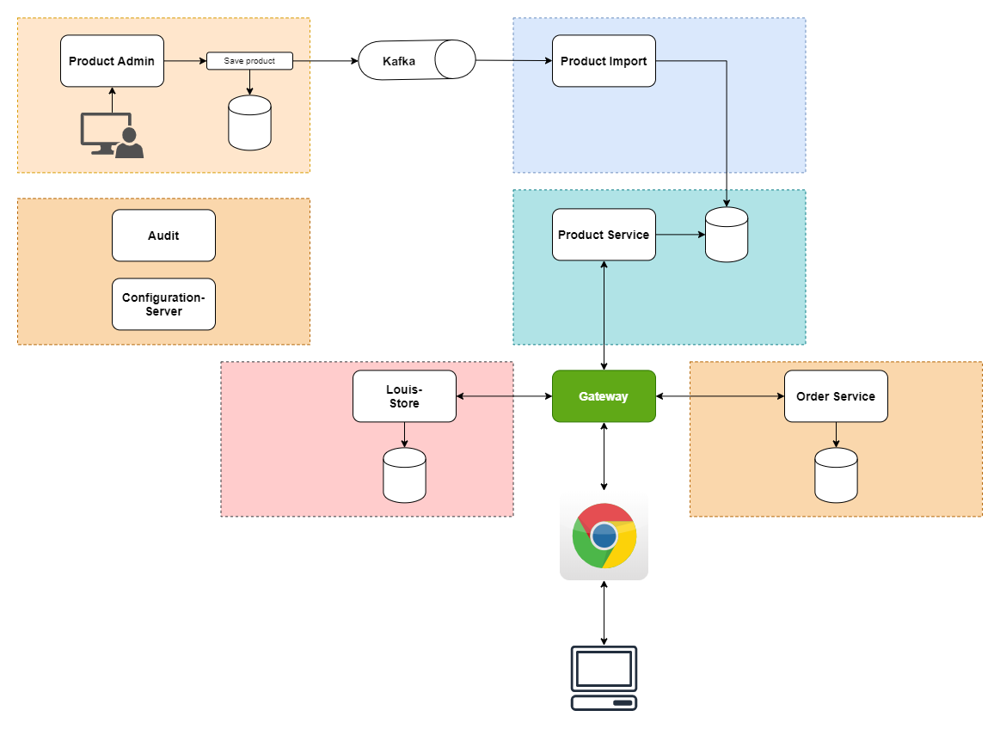

[](https://github.com/luanvuhlu/bookstore-microservices/actions/workflows/test.yml)  
# bookstore-microservices
A simple microservices sample project demonstrating a Spring Cloud microservices architecture.

## Technologies



## System Diagram



## Modules

- audit
- product-service
- product-import
- discovery-server
- configuration-server
- gateway
- order-service
- louis-store

## Requirements

- Java 11
- Maven (the repository includes the Maven wrapper)

## Build

### Maven Build

Windows:

    .\mvnw.cmd clean package

Unix/macOS:

    ./mvnw clean package

To run a single service using the Maven wrapper (build other modules as needed):

Windows:

    .\mvnw.cmd -pl product-service spring-boot:run -am

Unix/macOS:

    ./mvnw -pl product-service spring-boot:run -am

### Docker Build

The project uses GitHub Maven packages for dependencies. You need to provide GitHub credentials to build Docker images.

**Prerequisites:**
1. Generate a GitHub Personal Access Token with `read:packages` permission
2. Set the credentials as environment variables
3. Docker BuildKit must be enabled (it's enabled by default in Docker 23.0+)

**Windows PowerShell:**
```powershell
$env:GITHUB_USERNAME = "your-github-username"
$env:GITHUB_TOKEN = "your-github-token"
.\docker-build.ps1
```

**Unix/macOS:**
```bash
export GITHUB_USERNAME="your-github-username"
export GITHUB_TOKEN="your-github-token"
./docker-build.sh
```

**Manual Docker build for a single service:**

The build uses Docker BuildKit secrets for secure credential handling (credentials are NOT stored in image layers or build cache):

```bash
# Enable BuildKit (if not already enabled)
export DOCKER_BUILDKIT=1

# Build with secrets
docker build \
  --secret id=github_username,env=GITHUB_USERNAME \
  --secret id=github_token,env=GITHUB_TOKEN \
  -f product-service/Dockerfile \
  -t product-service:latest \
  .
```

**Windows PowerShell:**
```powershell
$env:DOCKER_BUILDKIT = "1"

docker build `
  --secret id=github_username,env=GITHUB_USERNAME `
  --secret id=github_token,env=GITHUB_TOKEN `
  -f product-service/Dockerfile `
  -t product-service:latest `
  .
```

## TODO

- [x] Zipkin
- [x] Spring Cloud Feign
- [ ] OAuth
- [x] Kubernetes
- [x] Spring Cloud Configuration
- [x] Spring Cloud Stream
- [ ] Ribbon
- [ ] Prometheus
- [ ] ElasticSearch
- [ ] HashiCorp Vault
- [x] Jenkins
- [x] Sonarqube
- [ ] Fault Tolerance
- [x] Liquibase
- [x] Kotlin projects
- [x] Python projects

Detail tasks at [ClickUp](https://app.clickup.com/14355871/v/s/32109655)
